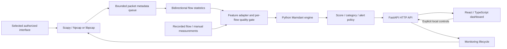

# Fuzzy Network Traffic Risk Analysis


Explainable, flow-based network traffic risk analysis with a Mamdani fuzzy
inference engine, a local FastAPI backend and a React dashboard
(**Fuzzy Network Security**). Each finalized network flow receives a **0–100 risk
score**, a linguistic risk level and the exact rules that produced it.

> **Educational and experimental.** This is not a validated intrusion detection
> system. Risk scores are not attack probabilities, alerts are indicators rather
> than confirmed attacks, and the application never blocks traffic.

## Contents

- [Features](#features)
- [Quick start](#quick-start)
- [Using the application](#using-the-application)
- [How it works](#how-it-works)
- [Dataset and Git LFS](#dataset-and-git-lfs)
- [Evaluation and limitations](#evaluation-and-limitations)
- [Development](#development)
- [Documentation](#documentation)
- [License](#license)

## Features

- **Explainable inference:** five flow measurements, 22 interpretable rules,
  membership curves and degrees, activated-rule strengths and the aggregated
  output set with its centroid, all computed by the Python engine.
- **Alert policies:** Sensitive, Balanced and Conservative thresholds change only
  the alert decision, never the score.
- **Live monitoring (opt-in):** explicit interface selection and authorization,
  bidirectional IPv4 TCP/UDP flow reconstruction, per-flow capture-quality
  tracking and a clearly labelled synthetic replay that needs no capture driver.
- **Recorded traffic and evaluation:** curated CIC-IDS2017 examples with original
  labels, historical and internal metrics with their evaluation scope, dataset
  provenance and model-development history.
- **Local and private:** loopback-only HTTP API, no packet payloads stored, no
  dataset download needed to run the dashboard.
- **Command-line scoring** with the same model and policies as the web app.

## Quick start

### Prerequisites

| Requirement | Version / note |
|---|---|
| Git + Git LFS (or GitHub Desktop) | LFS only needed for the dataset archive |
| Python | 3.12 or newer with `venv`/`pip`; 3.14 matches the validated stack |
| Node.js + npm | Node 24.15+ (24.x) or 22.22.2+ (22.x), npm 10+ |
| Windows PowerShell | For the Windows launcher; GNU Make is optional |
| Npcap (Windows) or libpcap permissions | Only for live capture |

### Windows

```powershell
git lfs install
git clone https://github.com/hfkarabas/Fuzzy-Network-Traffic-Risk-Analysis.git
cd Fuzzy-Network-Traffic-Risk-Analysis

# First time only: repository-local .venv (web profile) and npm packages, then build the UI
py -3 scripts/dev.py setup
npm.cmd --prefix web run build

# Every time
.\scripts\start-web.ps1
```

Open **http://127.0.0.1:8000** (API reference: **http://127.0.0.1:8000/docs**).
Keep the terminal open; **Ctrl+C** stops the server and any monitoring session.
Rebuild the UI after pulling frontend changes (`.\scripts\start-web.ps1 -Build`).

If PowerShell blocks scripts, run it for this process only (the saved execution
policy is not changed):

```powershell
powershell.exe -NoProfile -ExecutionPolicy Bypass -File .\scripts\start-web.ps1
```

The setup helper never installs Python, Node, Make or capture drivers globally;
it creates `.venv` if missing and reuses healthy installations.

### Development mode (Make)

With GNU Make, `make` prepares missing dependencies and starts Vite on
**http://127.0.0.1:5173** with FastAPI on **http://127.0.0.1:8000**. Without
Make, call `py -3 scripts/dev.py <target>` (Windows) or `python3 scripts/dev.py <target>`.

| Target | Action |
|---|---|
| `make` / `make run` | Prepare dependencies; run FastAPI + Vite |
| `make setup` | Prepare the web profile and npm packages only |
| `make backend` / `make frontend` | Run one side only |
| `make test` | Contributor profile; full pytest and Vitest suites |
| `make lint` | Ruff lint + format check, TypeScript typecheck |
| `make build` | Typecheck and production build of the frontend |
| `make check` | Report readiness without installing anything |

Native Windows startup is verified. Linux/macOS paths are implemented but have not
received equivalent native capture/startup validation. Details:
[launcher guide](docs/launcher.md).

### Dependency profiles

Each `requirements*.txt` file is an exact, tested lock (including transitive
packages); `pyproject.toml` declares the matching ranges as extras.

| Lock file | Extra | Contents | Installed by |
|---|---|---|---|
| `requirements.txt` | — | Core engine: NumPy, pandas | Every profile |
| `requirements-web.txt` | `[web]` | Core + FastAPI/Uvicorn | `make setup`, `start-web.ps1 -Install` |
| `requirements-live.txt` | `[live]` | Web + Scapy (capture/replay) | Manually, see below |
| `requirements-research.txt` | `[research]` | Core + dataset, fitting and report tooling | `scripts/setup.ps1` or manually |
| `requirements-dev.txt` | `[dev]` | Live + research + pytest, httpx, Ruff | `make test`, `make lint` |

### Optional live capture

```powershell
py -m pip --python .venv install -r requirements-live.txt
```

On Windows install [Npcap](https://npcap.com/#download) yourself and review its
capture permissions; the application never installs drivers or elevates itself.
Offline analysis works without capture support; synthetic replay needs Scapy but
no interface or driver. See [real-time monitoring](docs/realtime-monitoring.md).

## Using the application

| Page | Purpose |
|---|---|
| Live Traffic | Authorized interface capture or synthetic replay, session statistics, flow list and inspection |
| Security Overview | Engine configuration and recorded-traffic inventory |
| Risk Analysis | Manual or recorded measurements, risk assessment and fuzzy visualizations |
| Recorded Traffic | Curated dataset flows with their original labels |
| Model Performance | Recorded evaluation metrics and confusion matrices with their scope |
| System Information | Application and model versions, policy thresholds and the rule inventory |
| Dataset Information | Provenance, class distribution, preparation, calibration and model history |

**Monitoring live traffic**

1. In **Live Traffic**, select the interface and confirm that you are authorized
   to monitor it, then choose **Start monitoring**. Changing pages or closing the
   browser does not stop the session; **Stop monitoring** does.
2. Flows are scored when they finalize (TCP FIN/RST or a 15-second idle timeout),
   not per packet. Empty traffic legitimately produces no rows.
3. **Inspect flow** shows endpoints, duration, completion reason, the five
   observed inputs, memberships, activated rules, the output/centroid plot and the
   decision under all three policies. Partial segments are labelled as such.
4. Flows that missed a packet (queue loss, unusable packet between the same hosts,
   capture error) abstain and show the reason; other flows are still scored.

For a driver-free demonstration choose **Synthetic packet replay**: six fixed test
packets, never presented as live observations and never transmitted.

**Command line**

```powershell
.\.venv\Scripts\python.exe scripts\score_flow.py --input config\fuzzy\example_flow.json --policy Balanced
```

Accepts one JSON object or an array, verifies the deployed configuration hashes
and exits with `0` (scored), `1` (abstained) or `2` (error). Reference:
[fuzzy API and CLI](docs/fuzzy_api.md).

**HTTP API** (loopback only; interactive reference at `/docs`)

| Method | Path | Purpose |
|---|---|---|
| GET | `/api/health` | Status, `app_version`, model ID |
| GET | `/api/model`, `/api/policies` | Model metadata, rules, memberships; policy thresholds |
| POST | `/api/analyze` | Score five measurements under a policy |
| POST | `/api/visualization/output` | Output memberships, aggregate and centroid for one flow |
| GET | `/api/examples`, `/api/evaluation` | Recorded examples; evaluation summaries |
| GET | `/api/live/interfaces`, `/status`, `/flows`, `/stats`, `/errors` | Live monitoring state |
| POST | `/api/live/start`, `/api/live/stop` | Monitoring control (local origin + control token) |

```json
POST /api/analyze
{"features": {" Flow Packets/s": 100000, " Total Fwd Packets": 100, " Packet Length Mean": 6,
              " Bwd Packet Length Std": 0, " Down/Up Ratio": 0}, "policy": "Balanced"}
```

Invalid input returns HTTP 422 with a `null` score; dataset labels are rejected.

## How it works



Fuzzy inference runs only in Python; the Vite/React frontend draws SVG
visualizations of server results and polls live results every two seconds. No
capture socket is opened at startup and packet payloads are never stored.

### Fuzzy inference model

The deployed configuration is
[`config/fuzzy/task04/selected_v4.json`](config/fuzzy/task04/selected_v4.json),
integrity-checked at startup against its
[manifest](config/fuzzy/task04/selected_manifest.json). It is a rule-based Mamdani
system, not a machine-learning classifier. Each input has three overlapping
triangular/trapezoidal sets with frozen, training-derived boundaries that saturate
outside the configured domain. Column names keep the dataset's leading spaces:

| Input column | Measurement | Transform |
|---|---|---|
| `" Flow Packets/s"` | Observed packets per second | `log1p` |
| `" Total Fwd Packets"` | Packets in the first-observed direction | `log1p` |
| `" Packet Length Mean"` | Mean transport-payload length, bytes | identity |
| `" Bwd Packet Length Std"` | Backward payload-length sample std, bytes | `log1p` |
| `" Down/Up Ratio"` | Integer backward/forward packet-count ratio | identity |

AND and implication use **minimum**; OR and aggregation use **maximum**;
defuzzification is the **centroid** on a 201-point grid. Invalid or missing
measurements, or no activated rule, make the system **abstain** instead of
producing a score.

| Risk level | Score interval |
|---|---|
| Low | `[0, 25)` |
| Medium | `[25, 50)` |
| High | `[50, 75)` |
| Critical | `[75, 100]` |

Alerts use `score >= policy threshold`, independently of the levels
([`selected_policies.json`](config/fuzzy/task04/selected_policies.json)):

| Policy | Threshold | Calibration FPR target |
|---|---:|---:|
| Sensitive | 49.632522849397134 | 10% |
| Balanced (default) | 51.809236850031304 | 5% |
| Conservative | 59.465890915130174 | 1% |

FPR targets describe signature-group-weighted calibration, not guarantees for
live traffic.

### Live flow extraction

Flows are keyed by protocol and the canonical pair of IPv4 address/port
endpoints. Defaults: 15-second idle timeout, 120-second maximum segment age,
4,096 active flows, a 4,096-entry metadata queue and 200 retained results.
Stop, time-limit and eviction segments are marked partial. The extraction profile
reproduces documented legacy CICFlowMeter conventions (duplicated first payload
length in the mean, integer direction ratio); exact equivalence to the original
exporter is unverified. Packet loss and rejected packets are attributed to the
affected flows only. See the
[compatibility mapping and quality rules](docs/realtime-monitoring.md).

## Dataset and Git LFS

[CIC-IDS2017 on Hugging Face](https://huggingface.co/datasets/c01dsnap/CIC-IDS2017)
is the development and evaluation source: **2,830,743 records, 79 original columns
and 15 labels**. The versioned parsed-source archive
`datasets/cic_ids2017_v1.parquet` (**276,625,347 bytes**) is tracked with Git LFS
and preserves source values, types, row order, labels, duplicates and invalid
values. It is neither a packet capture nor the cleaned model input.

**The application runs without the archive**; it uses small tracked
configurations, summaries and examples. To skip the download, clone with
`GIT_LFS_SKIP_SMUDGE=1`; fetch it later with:

```powershell
git lfs pull --include="datasets/cic_ids2017_v1.parquet"
```

Verification and offline reconstruction use the research profile and the
[`scripts/data`](scripts/README.md) tools; see the
[dataset/LFS guide](docs/dataset_lfs.md),
[preprocessing](reports/dataset/preprocessing_report.md),
[provenance](reports/dataset/provenance.json) and
[data quality and leakage](reports/dataset/data_quality_and_leakage.md).

## Evaluation and limitations

Recorded **signature-group-weighted means across three internal folds**, with
fold-specific calibrated Balanced thresholds. They are neither a new test of the
single deployed threshold nor independent live-deployment results.

| Configuration | Precision | Recall | F1 | FPR | ROC-AUC |
|---|---:|---:|---:|---:|---:|
| Retained flat baseline (deployed) | 17.46% | 21.08% | 0.1910 | 4.91% | 0.6383 |
| Research hierarchy (not deployed) | 25.76% | 31.66% | 0.2838 | 4.53% | 0.6553 |

The frozen baseline overlaps historical training and the internal folds were
reused adaptively. The hierarchy failed the day-stability gate (zero recall in
Tuesday/Wednesday stress checks) and was not deployed. Group-weighted rates
differ from pooled flow rates: the baseline's pooled flow FPR is **15.71%**.
Sources: [retained-model comparison](reports/fuzzy/task02b/comparison_summary.csv),
[architecture comparison](reports/fuzzy/task05/comparison.csv),
[partition integrity](reports/fuzzy/task02b/evaluation_integrity.md) and the
[selection decision](reports/fuzzy/task05/final_report.md).

**Limitations**

- Historical distribution and scenario shift and duplicate dependencies limit
  generalization; independently validated live detection accuracy is not
  established.
- Live extraction is not verified to be equivalent to the CICFlowMeter exporter;
  capture loss, NIC offload and mid-connection starts affect the inputs.
- IPv6 and IP fragment reassembly are not supported by the live profile; capture
  needs a compatible driver and permissions.
- The API binds to loopback and supports one backend process; do not expose the
  capture-control API through a proxy or run multiple workers.

## Development

### Project structure

```text
config/fuzzy/     Frozen model, policy and manifest files (deployed: task04/)
datasets/         Git LFS source archive (optional)
docs/             Technical documentation
reports/          Recorded evaluation evidence and research reports
scripts/          Launcher and CLI; data/, fuzzy/, research/, webapp/, validation/ tools
src/fuzzy_network_risk/
  engine.py, membership.py, rules.py, policy.py   Mamdani engine and alert policies
  realtime/                                     Capture, flow table, monitoring session
  webapp/                                       FastAPI app, service layer, English content
tests/            pytest suite
web/              React + TypeScript dashboard (Vite, Vitest)
```

Every script is listed with its purpose and dependency profile in the
[scripts index](scripts/README.md).

### Tests and quality checks

```powershell
make test    # contributor profile; pytest and Vitest
make lint    # Ruff lint + format check, TypeScript typecheck

# Without Make
py -m pip --python .venv install -r requirements-dev.txt
.\.venv\Scripts\python.exe -m pytest -q
npm.cmd --prefix web test
npm.cmd --prefix web run build
```

Tests use small committed fixtures and never download or process the full
dataset. After changing API responses, regenerate the frontend fixtures with
`scripts/webapp/build_web_test_fixture.py`. Python style is enforced by Ruff
(configuration in `pyproject.toml`); `.git-blame-ignore-revs` lists the
mechanical formatting commit.

### Continuous integration

[`.github/workflows/ci.yml`](.github/workflows/ci.yml) runs lint, pytest (Ubuntu
and Windows, Python 3.12 and 3.14), a web-profile API smoke test and the frontend
tests and build. By project decision it runs **only when started manually**:
**Actions** → **CI** → **Run workflow** (untick *full-matrix* for a quick
Ubuntu/Python 3.14 run). It never downloads the Git LFS dataset.

### Versioning

The application follows [Semantic Versioning](https://semver.org/); the single
source is `fuzzy_network_risk.__version__`, shared by the Python package, API
and frontend. The fuzzy model has its own identity (`model_id`,
`configuration_version`). Changes are recorded in the [changelog](CHANGELOG.md);
releases are tagged `vMAJOR.MINOR.PATCH`. Release verification evidence for 1.0.0
is in [the final report](reports/task10/report.md).

## Documentation

| Document | Topic |
|---|---|
| [docs/methodology.md](docs/methodology.md) | Dataset methodology and preparation constraints |
| [reports/fuzzy/fuzzy_system_design.md](reports/fuzzy/fuzzy_system_design.md) | Fuzzy system design: memberships, rules, calibration |
| [docs/fuzzy_api.md](docs/fuzzy_api.md) | Python engine contract and command-line scoring |
| [docs/web_application.md](docs/web_application.md) | Web application architecture and API behaviour |
| [docs/realtime-monitoring.md](docs/realtime-monitoring.md) | Live capture, flow extraction and quality rules |
| [docs/launcher.md](docs/launcher.md) | Setup, launcher targets and dependency state |
| [docs/dataset_lfs.md](docs/dataset_lfs.md) | Dataset archive, Git LFS and reconstruction |
| [docs/task02b_workflow.md](docs/task02b_workflow.md) | TASK 02B reproducibility and group-aware validation |
| [scripts/README.md](scripts/README.md) | Every command-line script |
| [CHANGELOG.md](CHANGELOG.md) | Release history and versioning policy |

## License

Application source is licensed under the [MIT License](LICENSE), copyright 2026
Hikmet Furkan Karabas. The dataset and third-party components, including Npcap,
are subject to their own terms.
