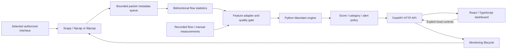

# Fuzzy Network Security

Local network traffic monitoring and explainable, flow-based risk analysis with a
FastAPI backend and an English React dashboard.

## Overview 

Fuzzy Network Security reconstructs bidirectional IPv4 TCP/UDP flows and evaluates
five numerical measurements with a 22-rule Mamdani fuzzy inference engine. Each
eligible, finalized observed flow receives a continuous-valued **0–100 risk score**,
a linguistic risk level and a rule-based explanation.

Capture runs continuously only after explicit authorization. Scores are published
when flow segments finalize, rather than for every packet. A separate alert policy
compares each score with a threshold; changing policy does not change the score.
The application monitors and analyzes traffic; it does not block connections or
perform automated mitigation.

## Features

- Explicit interface selection, authorization, start/stop and capture status.
- Bidirectional IPv4 TCP/UDP flow tracking with timeouts and bounded retention.
- Five-feature fuzzy inference, 22 interpretable rules and three alert policies.
- Risk gauge, configured membership curves, observed values and membership degrees.
- Activated-rule inspection, aggregated output membership plot and centroid marker.
- Recorded traffic analysis with original labels and reference results.
- Historical/internal performance metrics with clearly identified evaluation scope.
- Dataset Information with provenance, preparation, calibration and model history.
- Local dashboard, HTTP API and explicitly labeled synthetic packet replay.

## Architecture



The frontend uses Vite and SVG visualizations; fuzzy inference runs in Python,
not TypeScript. Live results are polled every two seconds. Scapy is optional;
o capture socket is opened at application startup. Packet payloads are not stored.

Default flow limits are a 15-second idle timeout, 120-second maximum segment age,
4,096 active flows, a 4,096-entry metadata queue and 200 retained results. User-stop,
time-limit and eviction segments are marked partial. Invalid/unavailable required
measurements cause abstention rather than fabricated scores.

## Fuzzy inference model

The active configuration is
[`config/fuzzy/task04/selected_v4.json`](config/fuzzy/task04/selected_v4.json).
It is a rule-based Mamdani system, not a conventional machine-learning classifier.
Each input has three overlapping triangular/trapezoidal sets with frozen,
training-derived boundaries and saturation outside the configured domain.

Exact source column names, including leading spaces, are preserved:

| Input column | Measurement | Transform |
|---|---|---|
| `" Flow Packets/s"` | Observed packets per second | `log1p` |
| `" Total Fwd Packets"` | Count in the first-observed direction | `log1p` |
| `" Packet Length Mean"` | Mean transport-payload length, bytes | Identity |
| `" Bwd Packet Length Std"` | Backward payload-length sample std, bytes | `log1p` |
| `" Down/Up Ratio"` | Integer backward/forward packet-count ratio | Identity |

AND and implication use **minimum**; OR and aggregation use **maximum**.
Defuzzification uses the **centroid** on a 201-point output grid. The live extraction
profile reproduces documented legacy CIC conventions, including a duplicated first
payload length in the mean and integer direction ratio. Exact equivalence to the
original dataset exporter is unverified; see the
[feature compatibility mapping](docs/realtime-monitoring.md).

| Risk level | Score interval |
|---|---|
| Low | `[0, 25)` |
| Medium | `[25, 50)` |
| High | `[50, 75)` |
| Critical | `[75, 100]` |

Alerts use `score >= policy threshold`, independently of these category boundaries:

| Policy | Active threshold | Calibration FPR target |
|---|---:|---:|
| Sensitive | 49.632522849397134 | 10% |
| Balanced | 51.809236850031304 | 5% |
| Conservative | 59.465890915130174 | 1% |

These targets describe signature-group-weighted calibration, not guarantees for
live traffic. The exact settings are in
[`selected_policies.json`](config/fuzzy/task04/selected_policies.json).
Risk scores are not attack probabilities; alerts are indicators, not confirmed attacks.

## Installation

### Prerequisites

- Git and Git LFS for an LFS-aware clone, or GitHub Desktop.
- Python **3.12+** with venv/pip support; Python **3.14** matches the validated stack.
- Native Node.js **24.15+ on 24.x**, or **22.22.2+ on 22.x**, with **npm 10+**.
- Windows PowerShell for the Windows launcher. GNU Make is optional.
- For actual capture: optional Scapy dependencies and Npcap on Windows, or
  appropriate libpcap/socket permissions on Linux/macOS. No GPU is needed.

Clone with Git LFS installed:

```powershell
git lfs install
git clone https://github.com/hfkarabas/Fuzzy-Network-Traffic-Risk-Analysis.git
cd Fuzzy-Network-Traffic-Risk-Analysis
```

### Windows setup and startup

Run from the repository root. First setup only:

```powershell
py -3 scripts/dev.py setup
npm.cmd --prefix web run build
```

The setup helper creates a repository-local `.venv` if absent, synchronizes pinned
Python packages and the npm lockfile, and reuses healthy installations. It does not
install Python, Node, Make or capture drivers globally.

**Normal startup:**

```powershell
.\scripts\start-web.ps1
```

Open **http://127.0.0.1:8000**. The built frontend and API share this origin;
API reference is **http://127.0.0.1:8000/docs**. Keep the terminal open and use
**Ctrl+C** to stop the server and its monitoring session. Later starts need only
the launcher; rebuild the frontend after pulling UI changes.

If PowerShell blocks scripts, use a process-scoped invocation:

```powershell
powershell.exe -NoProfile -ExecutionPolicy Bypass -File .\scripts\start-web.ps1
```

This does not change the saved execution policy. `-Build` rebuilds the UI; `-Dev`
starts the Vite development frontend. The launcher recognizes a matching application
already on port 8000; stop the owning terminal yourself before replacing it.

### Optional development workflow

With GNU Make already available, `make` prepares missing local dependencies and
starts Vite at **http://127.0.0.1:5173**, with FastAPI at **http://127.0.0.1:8000**.
Available targets: `setup`, `run`, `backend`, `frontend`, `test`, `build`, `check`,
`help`. Without Make, use `py -3 scripts/dev.py run` on Windows or
`python3 scripts/dev.py run` on POSIX. Ctrl+C stops the owned service trees.

See the [launcher guide](docs/launcher.md) for prerequisite installation and manual
commands, and the [scripts index](scripts/README.md) for every command-line tool. Native Windows startup is verified; Linux/macOS and Apple Silicon paths
are implemented but have not received equivalent native capture/startup validation.

### Dependency profiles

Python dependencies are split by purpose. Each `requirements*.txt` file is an exact,
tested lock (transitive packages included); `pyproject.toml` declares the matching
abstract ranges as optional extras.

| Lock file | Extra | Contents | Installed by |
|---|---|---|---|
| `requirements.txt` | — | Core fuzzy engine: NumPy, pandas | Included by every profile |
| `requirements-web.txt` | `[web]` | Core + FastAPI/Uvicorn | `scripts/dev.py setup`, `make`, `start-web.ps1 -Install` |
| `requirements-live.txt` | `[live]` | Web + Scapy for capture/replay | Manually (below) |
| `requirements-research.txt` | `[research]` | Core + dataset/LFS, fitting and report tooling | `scripts/setup.ps1` or manually |
| `requirements-dev.txt` | `[dev]` | Live + research + pytest/httpx | `make test` / `scripts/dev.py test` |

Running the dashboard needs only the web profile; the research and test tooling
(`datasets`, DuckDB, Arrow, Matplotlib, pytest) is no longer installed for it.

### Optional capture support

After normal setup, install Scapy into the existing local environment:

```powershell
py -m pip --python .venv install -r requirements-live.txt
```

Install [Npcap](https://npcap.com/#download) separately on Windows and review its
capture permissions. The application does not install drivers or elevate itself.
Offline analysis works without capture support. Replay also needs Scapy but does
not require a physical interface or capture driver. Detailed OS guidance and the
manual authorized-capture procedure are in
[Real-time monitoring](docs/realtime-monitoring.md).

## Dataset and Git LFS

[CIC-IDS2017 on Hugging Face](https://huggingface.co/datasets/c01dsnap/CIC-IDS2017)
is the historical development/evaluation source: **2,830,743 records, 79 original
columns and 15 labels**. The single versioned parsed-source archive is
`datasets/cic_ids2017_v1.parquet`, **276,625,347 bytes**, tracked through Git LFS.
It preserves source values/types, row order, labels, duplicates and invalid values;
it is not a packet capture or the cleaned model-input projection.

A normal LFS-aware clone retrieves the archive automatically. If the checkout
contains only its LFS pointer, retrieve the object from the repository root:

```powershell
git lfs pull --include="datasets/cic_ids2017_v1.parquet"
```

**The application can start without the full dataset.** Runtime uses small tracked
configurations, summaries and reference examples. To defer the archive download,
set `GIT_LFS_SKIP_SMUDGE=1` for cloning, then retrieve it later. LFS storage/bandwidth
limits apply; see the [dataset/LFS guide](docs/dataset_lfs.md).

For optional local data reconstruction, use the documented archive verification
and restoration scripts. Restoration refuses a populated working-data directory.
See [preprocessing](reports/dataset/preprocessing_report.md),
[provenance](reports/dataset/provenance.json) and
[data quality/leakage](reports/dataset/data_quality_and_leakage.md).
These workflows are not part of dashboard startup.

## Usage

| Page | Purpose |
|---|---|
| Security Overview | Loaded engine configuration and recorded-traffic inventory |
| Risk Analysis | Manual/recorded inputs, risk assessment and fuzzy visualizations |
| Recorded Traffic | Saved flow examples and original labels, distinct from live results |
| Live Traffic | Authorized interface capture, status, flow list and inspection |
| Model Performance | Recorded evaluation metrics and confusion matrices |
| System Information | Actual model configuration, policy thresholds and rule inventory |
| Dataset Information | Provenance, class distribution, preparation, calibration and development evidence |

1. Start the application and open the local dashboard.
2. In **Live Traffic**, select the intended interface and confirm authorization.
3. Choose **Start monitoring**; use **Stop monitoring** to close capture explicitly.
   Changing pages or closing the browser does not stop the backend session.
4. Wait for flows to finalize through TCP termination or timeout. Inspect status,
   queue-loss and capture-error indicators; empty traffic legitimately produces no rows.
5. Choose **Inspect flow** for endpoints, duration, completion reason, observed
   inputs, risk level and alert decision. Partial segments remain clearly labeled.
6. Inspect the five membership curves/degrees, activated rules and output/centroid
   plot. Compare policies; only the alert decision changes.
7. Use **Recorded Traffic** for saved examples, or enter measurements in **Risk Analysis**.
8. Review **Model Performance** and **Dataset Information** for evaluation context.

For a driver-free demonstration, explicitly select **Synthetic packet replay**
instead of an interface. These are test packets, never live observations. No packets
are transmitted by this replay. The application binds loopback; do not expose its
capture-control API through an untrusted proxy or run multiple backend workers.

## Evaluation

The following are recorded **signature-group-weighted means across three internal
folds**, with fold-specific calibrated Balanced thresholds. They are not a new test
of the single deployed threshold and are not independent live-deployment results.

| Configuration | Precision | Recall | F1 | FPR | ROC-AUC |
|---|---:|---:|---:|---:|---:|
| Retained flat baseline | 17.46% | 21.08% | 0.1910 | 4.91% | 0.6383 |
| Research hierarchy, not deployed | 25.76% | 31.66% | 0.2838 | 4.53% | 0.6553 |

The frozen baseline overlaps historical training and the internal folds were
adaptively reused. The hierarchy failed the day-stability gate, including zero
recall in Tuesday/Wednesday stress checks, so it did not replace production.
Group-weighted rates differ from raw pooled flow rates: the retained baseline's
pooled flow FPR is **15.71%**, not 4.91%.

Sources: [retained-model comparison](reports/fuzzy/task02b/comparison_summary.csv),
[architecture comparison](reports/fuzzy/task05/comparison.csv),
[partition integrity](reports/fuzzy/task02b/evaluation_integrity.md) and
[selection decision](reports/fuzzy/task05/final_report.md).

## Limitations

- Historical distribution/scenario shift and duplicate dependencies limit generalization.
- Exact equivalence between live extraction and the original CICFlowMeter exporter
  is unverified. Capture loss, offload and partial/mid-connection flows affect inputs.
- Capture requires a compatible driver and permissions; IPv6 and IP reassembly are
  not supported by the current live profile.
- Independently validated live intrusion-detection accuracy is not established.
- Scores are not probabilities; alerts are indicators, not confirmed attacks or
  evidence of automatic blocking.
  
### Verification

```powershell
npm.cmd --prefix web test
npm.cmd --prefix web run build
# Python regression tests need the contributor profile (includes optional packet tests):
py -m pip --python .venv install -r requirements-dev.txt
.\.venv\Scripts\python.exe -m pytest -q
```

The build includes TypeScript checking. Ordinary tests use small fixtures rather
than downloading or processing the complete dataset. Release verification and its
platform/capture boundaries are recorded in [the final report](reports/task10/report.md).

## License

Application source is licensed under the [MIT License](LICENSE), copyright 2026
Hikmet Furkan Karabas. Consult the dataset and third-party components' own terms,
including Npcap, for their respective use and distribution permissions.
